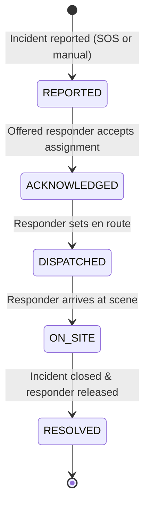
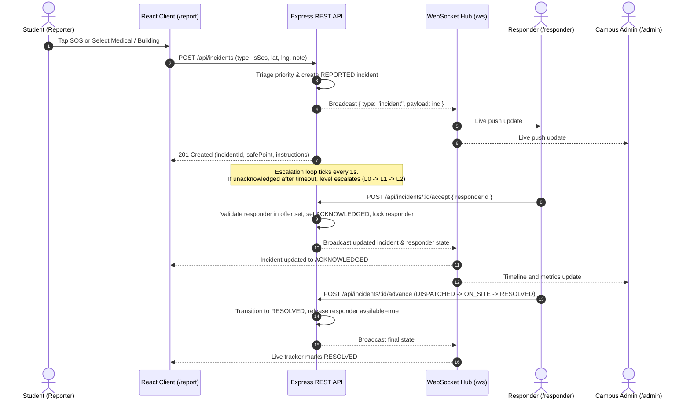

# CampusShield — Architecture & Design

Campus emergency response coordination prototype: instant reporting, automatic triage, proximity-based responder offer sets, rule-based escalation, and real-time live synchronization.

## 1. System Overview & Module Map

CampusShield is organized as a strict TypeScript monorepo with three workspace packages:

```
campus-shield/
├── shared/                 # Pure TypeScript definitions shared between client and server
│   └── src/
│       ├── types.ts        # Enums (IncidentType, Priority, IncidentStatus, ResponderRole) and DTOs
│       └── index.ts
├── server/                 # Express REST + WebSocket server + SQLite
│   ├── data/               # Seed data (campus.json: 10 buildings, 5 safe points; instructions.json)
│   └── src/
│       ├── domain/         # PURE business logic: no express, no ws, no sqlite, no Date.now()
│       │   ├── geo.ts          # Haversine distance and nearest landmark calculations
│       │   ├── triage.ts       # Priority (CRITICAL/HIGH/MEDIUM) and role alerting rules
│       │   ├── assignment.ts   # Offer set computation based on role, availability, escalation level
│       │   ├── workflow.ts     # State machine transitions: validates transitions & produces events
│       │   ├── escalation.ts   # Rule-based escalation level calculation
│       │   └── metrics.ts      # Summary analytics derived from append-only incident events
│       ├── db/             # Data access layer
│       │   ├── schema.ts       # DDL table creation and indexes
│       │   ├── seed.ts         # 6 initial responders (2 Security, 2 Medical, 2 Fire)
│       │   ├── db.ts           # SQLite connection and migration setup
│       │   └── repo.ts         # All SQL prepared statements (only SQL in the project)
│       ├── ws/
│       │   └── hub.ts          # WebSocket connection registry & event broadcasting
│       ├── services/
│       │   └── service.ts      # Orchestrates repository, pure domain modules, and WS hub
│       ├── escalation/
│       │   └── escalationLoop.ts # Periodic 1s clock tick verifying SLA timeouts
│       ├── simulator.ts    # Seeded PRNG incident generator and automated workflow stepper
│       ├── routes/         # Zod-validated REST endpoints (/api/incidents, /api/responders, etc.)
│       ├── app.ts          # Express application factory
│       └── index.ts        # Production entry point and static client hosting
├── client/                 # React 18 + Vite + Leaflet frontend
│   └── src/
│       ├── api.ts          # Strongly typed client fetch API
│       ├── hooks/          # React hooks (useLiveIncidents with WS auto-reconnect)
│       ├── pages/          # React views: /report, /responder, /admin
│       ├── styles/
│       │   └── tokens.css  # Unified design tokens (colors, spacing, shadows)
│       ├── App.tsx         # Route setup and persistent emergency footer
│       └── main.tsx
└── scripts/
    └── smoke.ts            # Autonomous end-to-end integration test
```

## 2. Incident Lifecycle State Diagram

All status transitions are strictly linear and immutable via `workflow.transition()`. Each change emits an immutable incident event.



## 3. End-to-End Sequence Diagram



## 4. Data Model

All persistence is managed via prepared statements in `server/src/db/repo.ts`.

### `incidents`
| Column | Type | Description |
|---|---|---|
| `id` | TEXT (PK) | UUID v4 |
| `type` | TEXT | `MEDICAL`, `FIRE`, `THREAT`, `ACCIDENT` |
| `priority` | TEXT | `CRITICAL`, `HIGH`, `MEDIUM` |
| `status` | TEXT | `REPORTED`, `ACKNOWLEDGED`, `DISPATCHED`, `ON_SITE`, `RESOLVED` |
| `is_sos` | INTEGER | 1 if SOS shortcut, 0 otherwise |
| `lat` | REAL | Coordinate latitude |
| `lng` | REAL | Coordinate longitude |
| `location_label` | TEXT | Building or area label |
| `note` | TEXT | Reporter note or incident description |
| `assigned_responder_id` | TEXT (FK) | Id of assigned responder (or NULL) |
| `escalation_level` | INTEGER | Current escalation tier (0, 1, or 2) |
| `created_at` | INTEGER | Epoch milliseconds timestamp |
| `resolved_at` | INTEGER | Epoch milliseconds timestamp (or NULL) |

### `responders`
| Column | Type | Description |
|---|---|---|
| `id` | TEXT (PK) | Responder identifier (e.g., `r1`..`r6`) |
| `name` | TEXT | Display name |
| `role` | TEXT | `SECURITY`, `MEDICAL`, `FIRE` |
| `lat` | REAL | Responder current coordinate latitude |
| `lng` | REAL | Responder current coordinate longitude |
| `available` | INTEGER | 1 if available, 0 if engaged in active incident |

### `incident_events`
| Column | Type | Description |
|---|---|---|
| `id` | TEXT (PK) | UUID v4 |
| `incident_id` | TEXT (FK) | Reference to `incidents.id` |
| `kind` | TEXT | `CREATED`, `TRANSITION`, `ESCALATED` |
| `status` | TEXT | Incident status at time of event |
| `at` | INTEGER | Epoch milliseconds timestamp |
| `note` | TEXT | Context or transition note |

## 5. Escalation Rules

1. Escalation applies **only while status is `REPORTED`**.
2. Formula: `level = min(2, floor(elapsedSeconds / ackTimeoutSeconds))`.
   - Default timeout: **60 seconds**.
   - Demo fast mode: **10 seconds**.
3. Offer set expansion:
   - **L0 (Level 0)**: 1 nearest available responder of primary role.
   - **L1 (Level 1)**: Up to 3 nearest available responders of primary role.
   - **L2 (Level 2)**: All available responders of primary role + Admin alert banner.
4. Ties between equidistant responders are deterministically resolved by lexicographical responder ID.

## 6. Design Decisions & Trade-Offs

- **Pure Domain (`server/src/domain/`)**: The business logic is strictly decoupled from framework dependencies (no Express, no ws, no SQLite, no `Date.now()`). All time is passed via an injected `Clock` function. This enables exhaustive and lightning-fast unit tests.
- **`tsx` in Production**: The server runs via `tsx` directly in both dev and production.
  - *Trade-off*: Eliminates redundant dual-stage transpilation artifacts and path alias synchronization bugs for rapid hackathon deployment. Uses slightly more memory on startup compared to raw pre-bundled Node code.
- **SQLite Single File Database**: Zero configuration and no external database container needed.
  - *Trade-off*: Free cloud container platforms (Render, Railway, Fly without mounted volumes) have ephemeral filesystems; restarting a free dyno re-seeds the database from initial data.
- **OpenStreetMap & Leaflet with Approximate Coordinates**: Campus buildings and safe points are mapped around Greater Noida Knowledge Park coordinates (~28.47°N, 77.49°E). These are marked approximate and should be mapped to high-precision surveyed points for real-world production.
- **Client Architecture**: Standard React 18 with React Router and Leaflet. No heavy UI framework or external state manager is used. State is maintained cleanly via the `useLiveIncidents` WebSocket hook.

## 7. Assumptions Recorded

1. **Campus Geography**: Approximate coordinates representing a university campus in Greater Noida, UP, India.
2. **Emergency Hotline**: Fallback emergency contact is set to Indian national helpline `112`.
3. **Authentication**: Hackathon prototype assumes trusted internal network (no JWT/OAuth). Responders pick their identity from a list.
4. **Geolocation**: Browser geolocation requires HTTPS in production; in local development, `http://localhost` is treated as a secure origin by modern browsers.
